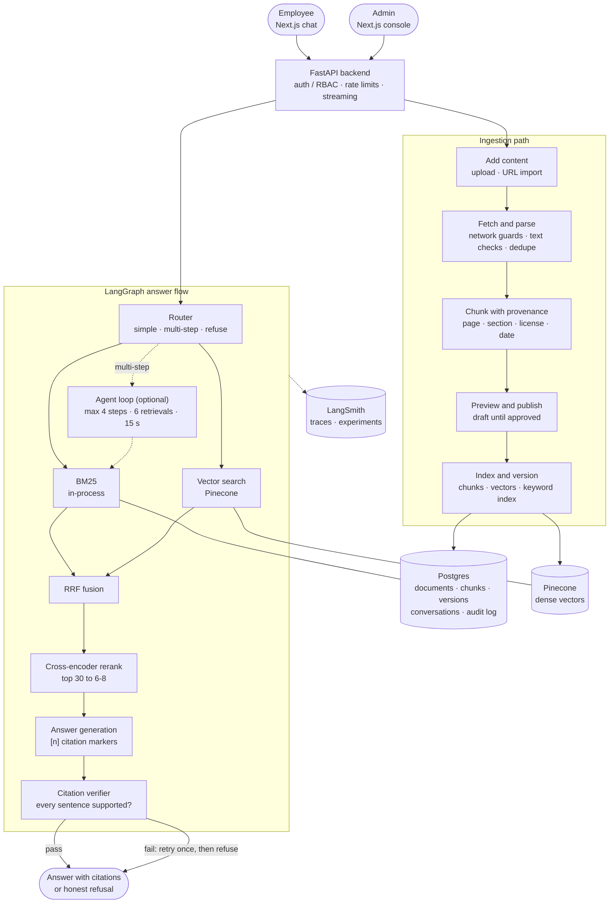
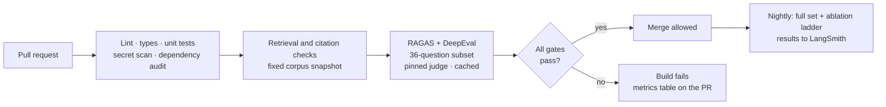

# CiteDesk

CiteDesk is a company-handbook assistant: employees ask questions in plain language and get answers where **every sentence cites the exact handbook passage it came from**. If the handbook does not support an answer, CiteDesk says so instead of guessing.

**Status:** specification and scaffold only; no application code yet.  
**Design baseline:** October 17, 2026  
**Demo corpus:** an openly licensed company handbook, to be chosen after its reuse terms are verified (see [`docs/product/dataset-feasibility.md`](docs/product/dataset-feasibility.md)). Nothing has been downloaded or ingested.

## Why this is a RAG system

The handbook is the organization's own, changing text. A general chatbot does not know a company's current policies, and answers about policy are only useful if the reader can check the clause. CiteDesk adds four things a plain chatbot does not provide:

1. **Checkable citations.** Each sentence links to the passage, page and last-updated date.
2. **Refusal when unsupported.** A verifier blocks uncited or unsupported sentences.
3. **Admin-controlled content.** Admins upload or import documents, preview them, and publish or roll back.
4. **Measured quality.** Faithfulness, answer relevancy and context precision are scored on every pull request and block regressions.

The first release includes a head-to-head against a plain chatbot (see the evaluation strategy). If the plain chatbot matches CiteDesk on the handbook questions, the scope is wrong and we stop and rethink.

## Start here

1. [`docs/product/prd.md`](docs/product/prd.md) — users, features, acceptance criteria, non-goals.
2. [`docs/architecture/technical-architecture.md`](docs/architecture/technical-architecture.md) — components, retrieval, citation verification, agentic flow, contracts.
3. [`docs/architecture/data-flow.md`](docs/architecture/data-flow.md) — step-by-step flows for ingestion, a question, and a gated code change.
4. [`docs/product/dataset-feasibility.md`](docs/product/dataset-feasibility.md) — candidate corpora, licensing status and open questions.
5. [`docs/evaluation/evaluation-strategy.md`](docs/evaluation/evaluation-strategy.md) — metrics, gates, golden questions, CI pipeline, cost controls.
6. [`docs/architecture/deployment.md`](docs/architecture/deployment.md) — environments and operations.
7. [`docs/architecture/project-structure.md`](docs/architecture/project-structure.md) — repository layout and module dependency rules.
8. [`docs/implementation/roadmap.md`](docs/implementation/roadmap.md) — phases, gates and definition of done.
9. [`docs/architecture/adrs.md`](docs/architecture/adrs.md) — decisions and open questions.
10. [`schemas/eval-case.example.json`](schemas/eval-case.example.json) and [`schemas/dataset-manifest.example.yaml`](schemas/dataset-manifest.example.yaml) — example shapes.

## What CiteDesk will do

- **Chat:** streaming answers with citation chips; clicking a chip opens the source drawer at the exact passage.
- **Hybrid retrieval:** in-process BM25 and Pinecone vector search, fused with Reciprocal Rank Fusion, then a cross-encoder reranker.
- **Citation enforcement:** a deterministic verifier checks every sentence; one stricter retry, then an honest refusal.
- **Admin console:** upload files or import URLs, preview chunks, publish, unpublish and roll back, with an audit log.
- **Quality gates:** RAGAS and DeepEval run in GitHub Actions and fail the build below thresholds.
- **Agentic RAG (optional, bounded):** only for multi-part questions, with a hard step budget. It stays only if the evaluation shows it helps.
- **Not included:** Graph RAG (a handbook is mostly prose; see ADR-005).

## Architecture



### Quality gate in CI



## Technology stack

| Layer | Choice |
| --- | --- |
| API | Python 3.12, FastAPI, Pydantic, `uv` |
| Orchestration | LangGraph (answer flow, optional agent), LangChain (model and retriever integrations) |
| Keyword search | In-process BM25 |
| Vector search | Pinecone dense index |
| Reranker | Cross-encoder (local ONNX model by default) |
| LLM | OpenAI behind an interface so another provider can be added |
| Metadata store | PostgreSQL |
| Observability | LangSmith, OpenTelemetry, structured logs |
| Evaluation | RAGAS, DeepEval, pytest, GitHub Actions |
| Frontend | Next.js, TypeScript, Tailwind, shadcn/ui |
| Quality tooling | Ruff, strict mypy, pytest, Vitest, Playwright, gitleaks, pip-audit, npm audit |

## Repository structure

```text
cite-desk/
  apps/web/                 Next.js: chat, admin console, quality dashboard
  src/citedesk/
    api/                    FastAPI routes, auth, rate limits, streaming
    ingestion/              sources, fetchers, parsers, chunking, provenance
    retrieval/              BM25, Pinecone store, fusion, reranker
    agents/                 LangGraph answer flow, router, step budget
    citations/              verifier and answer formatter
    llm/                    model and embedding adapters
    evaluation/             RAGAS and DeepEval runners, thresholds, reports
    db/                     schema and migrations
  evals/                    golden sets, thresholds, baselines
  infrastructure/           docker, terraform
  .github/workflows/        CI, PR evaluation, nightly evaluation, deploy
  docs/                     product, architecture, evaluation, implementation
  schemas/                  example manifests and eval cases
```

See [`docs/architecture/project-structure.md`](docs/architecture/project-structure.md) for the dependency rules between modules.

## Limits and honest caveats

- **Specification only.** Thresholds in the evaluation strategy are starting guesses; they are calibrated on the first measured baseline.
- **"Production-ready" means** the tests, gates, monitoring, backups and runbook exist and have been exercised. It does not mean the system has run under real load or on confidential data.
- **LLM judges vary** between runs, so gates use tolerance bands and cached judgments.
- **Corpus licensing is unverified.** No document is ingested until its terms are recorded in the source registry.
- CiteDesk gives information from the handbook it is given. It is not HR, legal or compliance advice.

## License

GPL-3.0. See [`LICENSE`](LICENSE).
