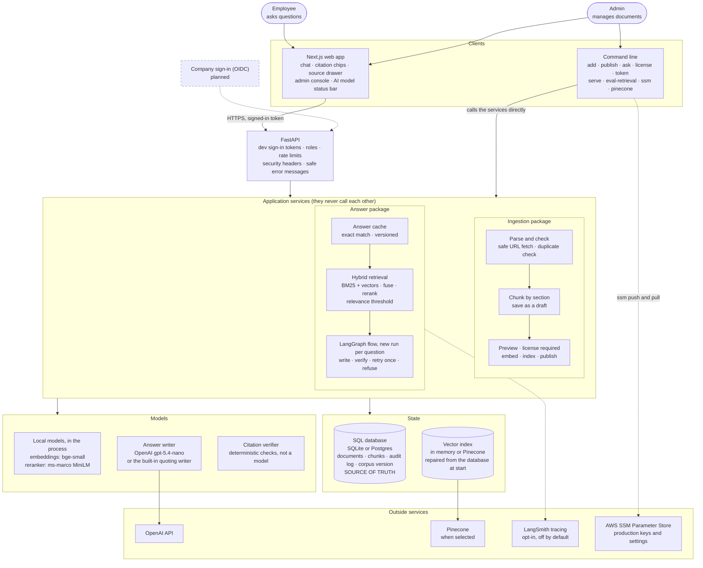
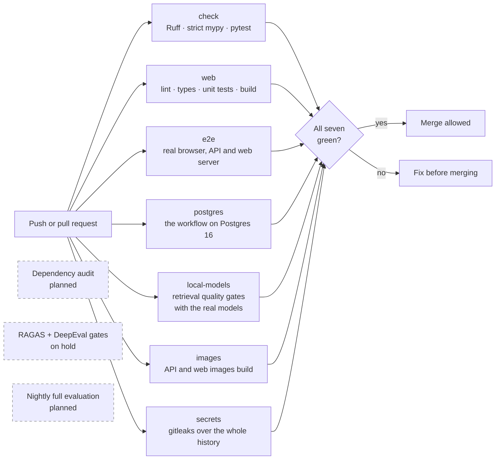
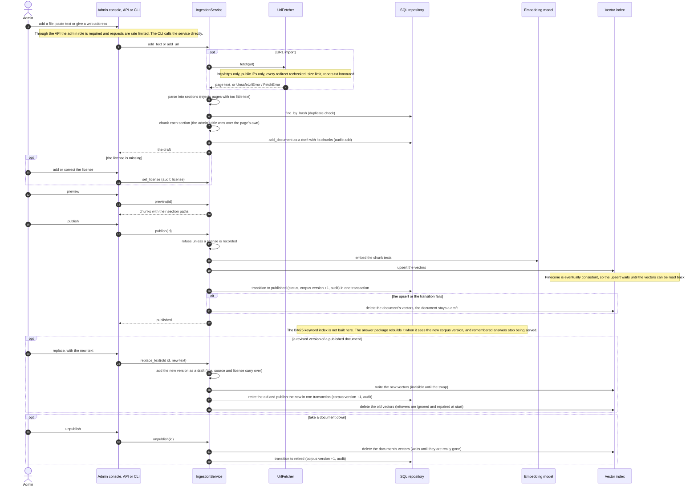
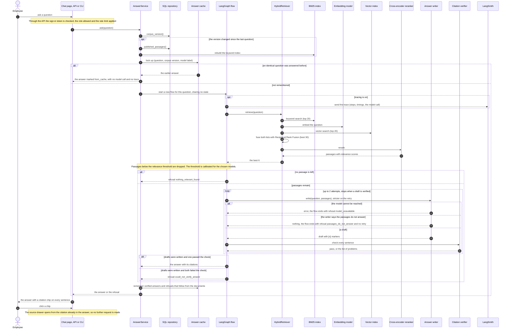
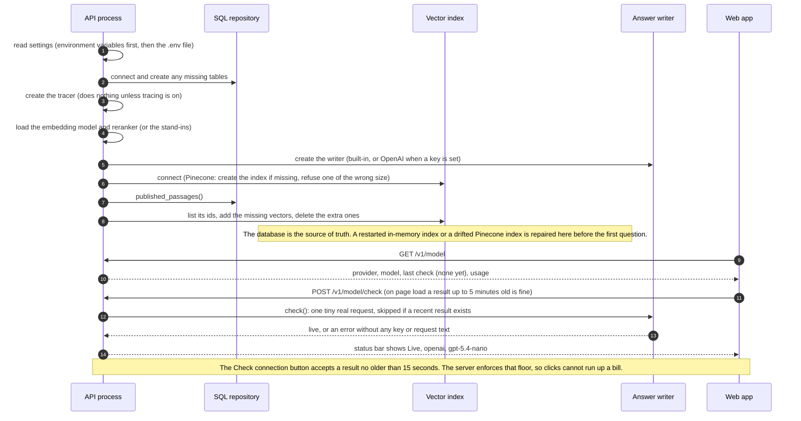

# CiteDesk

CiteDesk is a company-handbook assistant: employees ask questions in plain language and get answers where **every sentence cites the exact handbook passage it came from**. If the handbook does not support an answer, CiteDesk says so instead of guessing.

**Status:** backend core implemented and tested (ingestion, hybrid retrieval, citation verifier, LangGraph answer flow, CLI, retrieval and answer evaluation with quality gates). Runs on offline stand-ins by default or on real local embedding and cross-encoder models. Also a FastAPI layer with signed-in roles and rate limits. Also a Next.js web app: chat with citation chips and a source drawer, and an admin console. Also an OpenAI answer writer with a status bar in the web app, a Pinecone vector index, optional LangSmith tracing and an answer cache. Deliberately not built: an agent loop (measured, not needed: ADR-018) and Graph RAG. Not built yet: RAGAS and DeepEval (on hold), OIDC sign-in, streaming answers, saved conversations and feedback, the quality dashboard.  
**Design baseline:** October 17, 2026  
**Demo corpus:** an openly licensed company handbook, to be chosen after its reuse terms are verified (see [`docs/product/dataset-feasibility.md`](docs/product/dataset-feasibility.md)). Nothing has been downloaded or ingested.

## Why this is a RAG system

The handbook is the organization's own, changing text. A general chatbot does not know a company's current policies, and answers about policy are only useful if the reader can check the clause. CiteDesk adds four things a plain chatbot does not provide:

1. **Checkable citations.** Each sentence links to the passage, page and last-updated date.
2. **Refusal when unsupported.** A verifier blocks uncited or unsupported sentences.
3. **Admin-controlled content.** Admins upload or import documents, preview them, and publish or roll back.
4. **Measured quality.** Faithfulness, answer relevancy and context precision are scored on every pull request and block regressions.

The first release includes a head-to-head against a plain chatbot (see the evaluation strategy). If the plain chatbot matches CiteDesk on the handbook questions, the scope is wrong and we stop and rethink.

## Start here

1. [`docs/product/prd.md`](docs/product/prd.md) — users, features, acceptance criteria, non-goals.
2. [`docs/architecture/technical-architecture.md`](docs/architecture/technical-architecture.md) — components, retrieval, citation verification, agentic flow, contracts.
3. [`docs/architecture/data-flow.md`](docs/architecture/data-flow.md) — step-by-step flows for ingestion, a question, and a gated code change.
4. [`docs/product/dataset-feasibility.md`](docs/product/dataset-feasibility.md) — candidate corpora, licensing status and open questions.
5. [`docs/evaluation/evaluation-strategy.md`](docs/evaluation/evaluation-strategy.md) — metrics, gates, golden questions, CI pipeline, cost controls.
6. [`docs/architecture/deployment.md`](docs/architecture/deployment.md) — environments and operations.
7. [`docs/architecture/project-structure.md`](docs/architecture/project-structure.md) — repository layout and module dependency rules.
8. [`docs/implementation/roadmap.md`](docs/implementation/roadmap.md) — phases, gates and definition of done.
9. [`docs/architecture/adrs.md`](docs/architecture/adrs.md) — decisions and open questions.
10. [`schemas/eval-case.example.json`](schemas/eval-case.example.json) and [`schemas/dataset-manifest.example.yaml`](schemas/dataset-manifest.example.yaml) — example shapes.

## Run it locally

No API keys, Docker or cloud account are needed: the core runs on offline stand-ins and a local SQLite file.

### 1. Install the prerequisites

- **Git** and **[`uv`](https://docs.astral.sh/uv/getting-started/installation/)** (it installs the right Python, 3.12, for you).
- **`make`** is optional; it only wraps the commands in step 4.

### 2. Get the code

```bash
git clone https://github.com/Tevaalgorithms/cite-desk.git
cd cite-desk
```

### 3. Install dependencies

```bash
uv sync
```

### 4. Check that everything works

```bash
make check        # or: uv run ruff check . && uv run mypy && uv run pytest
```

You should see Ruff pass, mypy report no issues, and all tests pass.

### 5. Use the sample handbook

The repo includes a small, made-up handbook at [`data/sample/acme-handbook.md`](data/sample/acme-handbook.md) (fictional company, released as CC0). Example questions with known answers are in [`evals/sample/questions.json`](evals/sample/questions.json).

### 6. Add it, review it, publish it

```bash
uv run citedesk add data/sample/acme-handbook.md --title "Acme Handbook" --license "CC0 (synthetic sample)"
```

This saves the file as a **draft**, so nobody can search it yet, and prints its id, for example `Added e94cbc1cfce6 (2 chunks, draft)`. Publishing requires a recorded `--license`; without one it is refused.

```bash
uv run citedesk list                      # shows each document with its status
uv run citedesk publish <document-id>     # use the id printed above
```

To add and publish in one command, put `--publish` on the `add` line.

### 7. Ask questions

```bash
uv run citedesk ask "How many vacation days do I get?"
uv run citedesk ask "When do I need to return my laptop?"
uv run citedesk ask "What is the capital of France?"
```

The first two answer in the handbook's own words, with `[1]` markers and the section each came from. The third is not in the handbook, so CiteDesk says it can't answer. Try the other questions in `evals/sample/questions.json` too.

### 8. Take a document down

```bash
uv run citedesk unpublish <document-id>
uv run citedesk ask "How many vacation days do I get?"   # now refused
```

If the document was revised rather than withdrawn, swap in the new version in one step instead (the title, source and license carry over; the old version is kept as retired):

```bash
uv run citedesk replace <document-id> revised-handbook.md
```

### 9. Try your own document

```bash
uv run citedesk add path/to/your-file.md --title "My document" --license "<its license>" --publish
```

Markdown (`.md`), HTML (`.html`) and plain text files are supported. PDF, DOCX and web-page import from the command line are not available yet. The importer exists in code and is tested, but has no command.

### Where things are stored

- Documents, chunks and the audit log are in a SQLite file, `citedesk.local.db`, created in the folder you run the command from. It is git-ignored.
- To start fresh, delete that file. To use another location: `export CITEDESK_DATABASE_URL="sqlite:////full/path/to/file.db"`.
- The vector index is rebuilt in memory every time a command starts.

### Run the web app

Needs Node 22 or newer. With the API from the previous step running on port 8000:

```bash
cd apps/web
npm install
npm run dev                      # http://localhost:3000
```

Sign in by pasting a token from `uv run citedesk token --user you --role analyst` (use `--role admin` for the Admin page). As an admin, add `data/sample/acme-facilities-guide.md` (or the handbook), preview it, and publish it. If you added it without a license, use **Add license** in its table row first; then ask questions as an analyst and click a numbered citation to see the source passage. The API address defaults to `http://localhost:8000`; set `NEXT_PUBLIC_API_URL` to change it, and add the web address to `CITEDESK_CORS_ORIGINS` if it is not `http://localhost:3000`.

Checks (from `apps/web`): `npm run lint`, `npm run typecheck`, `npm test`, `npm run build`, and `npm run e2e`, which starts its own API and web server and drives a real browser through sign-in, upload, publish, a cited answer, the source drawer and unpublish (needs `npx playwright install chromium` once).

### Let a language model write the answers (optional)

The default writer quotes the best sentence from the sources: free, no key, but it cannot combine facts and sometimes answers a question from a nearby section. To use OpenAI instead, put your key and a model in `.env` (never in a committed file):

```bash
CITEDESK_WRITER=openai
CITEDESK_OPENAI_API_KEY=<your key>
CITEDESK_OPENAI_MODEL=gpt-5.4-nano       # the cheap default; gpt-5.4-mini is slightly more thorough
```

Every sentence is still checked against its source, and the app refuses rather than guesses. The top bar of the web app shows which model is answering ("Live · openai · gpt-5.4-nano") with a **Check connection** button. Measured quality and cost are in [`docs/evaluation/evaluation-strategy.md`](docs/evaluation/evaluation-strategy.md); a question costs a fraction of a cent. To test the real model: `CITEDESK_RUN_LLM_TESTS=1 uv run pytest tests/llm --no-cov` (a few cents).

### Keep vectors in Pinecone (optional)

By default vectors are kept in memory and rebuilt from the database at every start. To keep them in Pinecone instead (needs `CITEDESK_PINECONE_API_KEY` in `.env` and the real models, because the index size must match the embedding model):

```bash
CITEDESK_MODELS=local CITEDESK_VECTOR_INDEX=pinecone uv run --extra models citedesk pinecone init   # once
CITEDESK_MODELS=local CITEDESK_VECTOR_INDEX=pinecone uv run --extra models citedesk pinecone status
```

Put `CITEDESK_VECTOR_INDEX=pinecone` in `.env` to use it for everything. The database stays the source of truth: at start the index is repaired to match it, and `citedesk pinecone sync` does the same on demand. Each environment uses its own namespace (`CITEDESK_ENVIRONMENT`, default `dev`), so development and production never see each other's vectors. Test against the real index with `CITEDESK_RUN_PINECONE_TESTS=1 uv run --extra models pytest tests/live_pinecone --no-cov`.

### Trace answers in LangSmith (optional)

Set `CITEDESK_LANGSMITH_TRACING=true` (and `CITEDESK_LANGSMITH_API_KEY`) to record each answer's steps, timings and model call in your LangSmith project. **A trace contains the question and, unless you also set `CITEDESK_LANGSMITH_HIDE_CONTENT=true`, the handbook passages, which leaves this system.** It is off by default. Repeated questions are answered from a small in-memory cache (`CITEDESK_ANSWER_CACHE_SIZE`, `0` turns it off) that is invalidated whenever documents are published or removed.

### Use the real local models (optional)

The default `offline` backend uses word-matching stand-ins. To use a real embedding model and cross-encoder that run on your machine (no API key; model files are downloaded on first use, size not measured):

```bash
uv sync --extra models
export CITEDESK_MODELS=local
uv run citedesk add data/sample/acme-handbook.md --title "Acme" --license "CC0 (synthetic sample)" --publish
uv run citedesk ask "How much time off do I get when I have a baby?"   # a paraphrase the stand-ins refuse
```

### Use Postgres instead of SQLite (optional)

```bash
uv sync --extra postgres
docker run -d --rm --name citedesk-pg -e POSTGRES_PASSWORD=<pick a password> -p 55432:5432 postgres:16-alpine
export CITEDESK_DATABASE_URL="postgresql+psycopg://postgres:<the password>@localhost:55432/postgres"
uv run citedesk list            # creates the tables on first use

# run the Postgres tests
CITEDESK_TEST_POSTGRES_URL="$CITEDESK_DATABASE_URL" uv run pytest tests/integration
```

Tables are created automatically on first start; schema migrations are not implemented yet.

### Run everything in Docker

```bash
cp .env.example .env     # then set CITEDESK_JWT_DEV_SECRET (see the comment in the file)
export CITEDESK_LOCAL_DB_PASSWORD=<pick a password>      # for the bundled trial Postgres
# in .env, point the database at it:
# CITEDESK_DATABASE_URL=postgresql+psycopg://postgres:<that password>@postgres:5432/citedesk
docker compose -f infrastructure/docker/compose.yml --env-file .env --profile local-db up -d --build
scripts/smoke.sh http://localhost                         # quick health and security checks
```

This starts the API, the web app and a Caddy proxy on one address (port 80), plus a trial Postgres with the `local-db` profile. For the Lightsail deployment steps see [`docs/operations/lightsail-deploy.md`](docs/operations/lightsail-deploy.md).

### Run the web API

```bash
export CITEDESK_JWT_DEV_SECRET="$(python3 -c 'import secrets; print(secrets.token_urlsafe(48))')"
uv run citedesk serve                      # http://127.0.0.1:8000

# in another terminal, with the same CITEDESK_JWT_DEV_SECRET exported
ADMIN=$(uv run citedesk token --user alice --role admin)
ANALYST=$(uv run citedesk token --user bob --role analyst)
curl -s localhost:8000/health
curl -s -X POST localhost:8000/v1/chat -H "Authorization: Bearer $ANALYST" \
  -H 'content-type: application/json' -d '{"question":"How many vacation days do I get?"}'
```

Chat and source passages need any signed-in role; document management and the audit log need `admin`. Tokens are for local development only: production should verify tokens from an OIDC provider (planned). Set `CITEDESK_ENABLE_API_DOCS=true` to see interactive docs at `/docs`. Endpoints are listed in [`docs/architecture/technical-architecture.md`](docs/architecture/technical-architecture.md).

### Measure quality

```bash
uv run citedesk eval-retrieval --models offline                    # stand-ins
uv run --extra models citedesk eval-retrieval --models local       # real models
uv run --extra models citedesk eval-retrieval --models local --golden evals/sample/heldout.json
uv run --extra models citedesk eval-retrieval --models local --check evals/baselines.json   # quality gate
```

It prints Recall@1/3/5 and MRR for each retrieval stage, the relevance-threshold calibration, and how many answers were correct, refused or wrongly cited. Results and their limits are in [`docs/evaluation/evaluation-strategy.md`](docs/evaluation/evaluation-strategy.md).

### Good to know

- The default offline stand-ins match on shared words only, so a question phrased with different words than the handbook may be refused. Use the real local models (above) for paraphrases.
- Even with real models, a question the handbook cannot answer can be answered from a nearby section (for example asking about cafeteria prices when only travel meals are covered). The cited passage is shown so you can see this; fixing it needs the language-model writer.
- There is no web chat, API or admin screen yet. See the roadmap.

### Troubleshooting

| Problem | Fix |
| --- | --- |
| `uv: command not found` | Install uv (step 1), then open a new terminal |
| `Record the document's license before publishing` | Re-add the file with `--license "..."` |
| `Same content already added as document ...` | That file is already stored; use `list` to find its id |
| `Only N characters of text found` | The file has too little text (error pages and empty files are rejected on purpose) |
| An answer says it cannot answer | Check the document is published (`list`) and use words close to the handbook's. For example "parental leave" works where "time off for a baby" does not |

## What CiteDesk does

- **Chat** with an answer for each question, a numbered citation chip on every sentence, and a source drawer that highlights the quoted passage. Answers arrive complete, not streamed, because each sentence is checked before it is shown.
- **Hybrid retrieval:** in-process BM25 and vector search (in memory or Pinecone), fused with Reciprocal Rank Fusion, then reranked by a cross-encoder.
- **An answer writer:** a language model (OpenAI, `gpt-5.4-nano` by default) that may only use the numbered passages and says so when they do not answer, or a built-in writer that quotes the best sentence with no model at all.
- **Citation enforcement:** a deterministic verifier checks every sentence, with one stricter retry and then an honest refusal.
- **Admin console:** upload files or import web pages, preview the chunks, add or correct a license, publish and unpublish, with an audit log. Nothing is searchable until it is published with a license.
- **An AI model status bar** showing which model answers and whether it is working, with a Check connection button.
- **Quality gates** in GitHub Actions: lint, types, tests, a real-browser test, the Postgres tests, retrieval quality gates on the real models, an image build and a secret scan.
- **Not built:** RAGAS and DeepEval (on hold), company sign-in (OIDC), streaming answers, saved conversations and feedback, a quality dashboard. **Decided against:** an agent loop (measured, not needed: ADR-018) and Graph RAG (ADR-005).

## Architecture

Solid boxes are built and tested. Dashed boxes are planned (see [`docs/implementation/roadmap.md`](docs/implementation/roadmap.md)).



Ingestion and the answer package never call each other. They meet only through the SQL database, the vector index and the shared interfaces in `src/citedesk/domain/ports.py`, and a test enforces that. The database is the source of truth: the vector index is a copy that is repaired from it at every start.

**What leaves your machine.** Questions and the retrieved passages go to OpenAI when the OpenAI writer is on. Vectors go to Pinecone when it is selected. Traces go to LangSmith only if you turn tracing on. The embedding model and reranker run locally.

### How an answer can end

| Outcome | When | Shown to the user as |
| --- | --- | --- |
| **Answer** | The writer's draft passed the verifier | The text with a numbered chip on every sentence |
| `nothing_relevant_found` | No passage scored above the relevance threshold | "I couldn't find that in the handbook" |
| `passages_do_not_answer` | Related passages exist, but the writer replied that they do not answer the question | "The handbook doesn't answer that" |
| `could_not_verify_answer` | Two drafts both failed the verifier | "I couldn't verify an answer" |
| `model_unavailable` | The OpenAI model could not be reached | "The AI model isn't reachable right now" |
| `empty_question` | Blank question | "Ask a question" |

Verified answers and the first two refusals are remembered by the cache; the other two are never cached, because they may succeed next time.

### Quality gate in CI



Tests that call real services (OpenAI, Pinecone, LangSmith) run only on request and never in CI: `tests/llm`, `tests/live_pinecone` and `tests/live_langsmith`. They use throwaway namespaces and projects and clean up after themselves. The RAGAS and DeepEval gates are designed in [`docs/evaluation/evaluation-strategy.md`](docs/evaluation/evaluation-strategy.md) but not implemented.

## Sequence diagrams

These follow the code in `src/citedesk/`. Steps marked planned do not exist yet.

### Ingestion path (admin adds a document)



### The journey of one document

Ingestion turns a document someone gives us into small, labeled, searchable pieces, and keeps it **invisible to users until an admin has reviewed it and recorded its license**. It never answers questions: the answer side reads only what ingestion publishes.

1. **It arrives.** An admin uploads a `.md`, `.html` or text file, pastes text, or gives a web address. In the web app a file is read in the browser and sent as text, up to 2 million characters. Through the API this needs the admin role and is rate limited.
2. **A safe fetch (web addresses only).** This is the riskiest step, because the server is asked to fetch a page on someone's behalf. It allows only `http` and `https`, and only **public** IP addresses (internal networks and cloud metadata addresses are refused, which blocks server-side request forgery). Every redirect is rechecked, with at most 3 hops. Pages over 5 MB are refused, `robots.txt` is honored (a missing one is fine, one that cannot be read means no fetch), and only HTML, markdown and plain text are accepted. PDFs are not.
3. **Parse.** The text is cut into **sections** by its headings, each with a path such as `Office access > Opening hours`. The top-level title becomes the document title and is left out of the paths. HTML is converted first: headings and paragraphs are kept, scripts, menus and page chrome are dropped. Anything under 100 characters of real text is rejected, which catches error and login pages.
4. **Duplicate check.** A fingerprint of the content is compared with what is stored. The same content added twice is refused, and the message names the existing document and its status.
5. **Chunk.** Each section becomes one or more chunks of at most about 1,200 characters, cut at sentence boundaries. A long section is split with a one-sentence overlap, so a fact that straddles a boundary still appears whole in one chunk. A chunk never crosses a section, so a citation can always name its section.
6. **Save as a draft.** The document and its chunks are stored with an audit entry (`add`). A draft is **invisible**: no question can find it.
7. **Preview and license.** The admin reviews the chunks. Publishing is refused without a recorded license, and the admin can add or correct it right in the document table (each change is audited as `license`). The admin's own title wins over the title found in the file.
8. **Publish.** In this order: check the license; embed each chunk's text, with the document title and section path included in what is embedded; write the vectors to the index and wait until the index can read them back (Pinecone applies writes late); then, in one transaction, set the status to published, add 1 to the corpus version and write an audit entry. If any step fails, the vectors are removed and the document stays a draft.
9. **What happens next, outside ingestion.** The new corpus version makes the answer side rebuild its keyword index and stops remembered answers from being served. **Unpublish** reverses this: the vectors are deleted (and the delete waits until it has really happened), the document is marked retired and the version goes up again. Retired documents are kept for the audit trail.

What is not built: PDF and Word files, page numbers, excluding a single chunk in the preview, scheduled refresh of imported web pages, and a "this version replaces the old one" flow (a changed document arrives as a new document, so the old one must be unpublished by hand). The address check happens before the fetch but the HTTP library resolves the name again, so the importer needs outbound network restrictions in production (see the operations notes in [`docs/operations/lightsail-deploy.md`](docs/operations/lightsail-deploy.md), which also says that is not yet worked out for Lightsail).

### Retrieval and answer path (employee asks a question)



### Start-up and the model status bar



## Technology stack

| Layer | Choice |
| --- | --- |
| API | Python 3.12, FastAPI, Pydantic, `uv` |
| Answer flow | LangGraph (retrieve, write, verify, retry or refuse). LangChain is not used directly |
| Keyword search | BM25, implemented in-process |
| Vector search | In-process index, or a Pinecone serverless index (`cite-desk`, 384 dimensions, cosine) |
| Embeddings and reranker | Local ONNX models through fastembed: `bge-small-en-v1.5` and `ms-marco MiniLM` (word-matching stand-ins when `CITEDESK_MODELS=offline`) |
| Answer writer | OpenAI (`gpt-5.4-nano` by default, any model by setting), or the built-in quoting writer |
| Citation check | Deterministic verifier written for this project |
| Database | SQLAlchemy over SQLite (local) or PostgreSQL 16 (both tested); tables are created at start, migrations are not built |
| Tracing | LangSmith, opt-in. Structured logging and OpenTelemetry are not built |
| Production secrets | AWS SSM Parameter Store, managed with `citedesk ssm` |
| Evaluation | A project harness with golden, held-out, unseen and multi-part question sets and baseline gates. RAGAS and DeepEval are on hold |
| Frontend | Next.js, React, TypeScript, plain CSS |
| Deployment | Docker images, a Caddy proxy and Docker Compose, aimed at one Amazon Lightsail instance (nothing deployed yet) |
| Quality tooling | Ruff, strict mypy, pytest, Vitest, Playwright, gitleaks. A dependency audit is planned |

## Repository structure

```text
cite-desk/
  apps/web/                 Next.js app: chat, citation chips, source drawer, admin console,
                            AI model status bar, browser end-to-end test (e2e/)
  src/citedesk/
    domain/                 shared data models and interfaces (ports)
    ingestion/              parse, chunk, safe URL fetch, draft / publish workflow
    answer/                 BM25, fusion, retrieval, cache, writers, verifier, LangGraph flow
    adapters/               local models, OpenAI writer, Pinecone index
    storage/                SQL repository, in-memory stand-ins
    api/                    FastAPI routes, sign-in tokens and roles, rate limits
    evaluation/             retrieval and answer evaluation, coverage, thresholds, gates
    ops/                    AWS SSM secrets tooling
    bootstrap.py            the only place that wires ingestion and answers together
    indexing.py             repairs the vector index from the database
    tracing.py              optional LangSmith tracing
    config.py, cli.py       settings and the command line
  tests/
    unit/                   fast tests, no network (the default run)
    integration/            the workflow on a real Postgres (opt-in)
    models/                 quality gates with the real local models
    llm/, live_pinecone/, live_langsmith/   real OpenAI / Pinecone / LangSmith (opt-in, a few cents)
  evals/                    golden, held-out, test and multi-part question sets, baselines.json
  infrastructure/docker/    Dockerfiles, Caddy proxy config and compose file
  scripts/                  smoke.sh: post-deploy checks
  .github/workflows/        ci.yml (seven jobs)
  docs/                     product, architecture (ADRs 001 to 020), evaluation, operations
  schemas/                  example manifests and eval cases
  data/sample/              synthetic handbooks used for trying it and for tests
```

See [`docs/architecture/project-structure.md`](docs/architecture/project-structure.md) for the dependency rules between modules.

## Limits and honest caveats

- **Small, synthetic evidence.** Quality was measured on a made-up handbook (about 15 chunks) with question sets written by the same author. They show the pipeline works and which part helps; they do not show how it will perform on a real handbook. Thresholds were calibrated on the same small sample.
- **Not deployed.** Nothing has run on a real server, with HTTPS on a real domain, under real load or with backups. Memory use of the local models on a 2 GB machine is unmeasured. "Production-ready" here means the tests, gates and runbook exist, not that it has run in production.
- **It can still answer a question the handbook cannot.** A question about a topic the handbook covers nearby can occasionally be answered from the neighbouring passage (the language model refused all 14 such questions in testing, but the set is small). Every answer shows the cited passage so a reader can check.
- **The language model sends data out.** With the OpenAI writer, each question and its retrieved passages are sent to OpenAI. Do not load confidential documents until the provider and retention decisions in ADR-004 are made. Tracing is off by default for the same reason.
- **Sign-in is a development stand-in.** Users paste a signed token; production sign-in through an identity provider is planned.
- **Corpus licensing is unverified** for any real handbook. A document cannot be published without a recorded license, but that records what an admin typed, not legal advice.
- CiteDesk gives information from the handbook it is given. It is not HR, legal or compliance advice.

## License

GPL-3.0. See [`LICENSE`](LICENSE).
