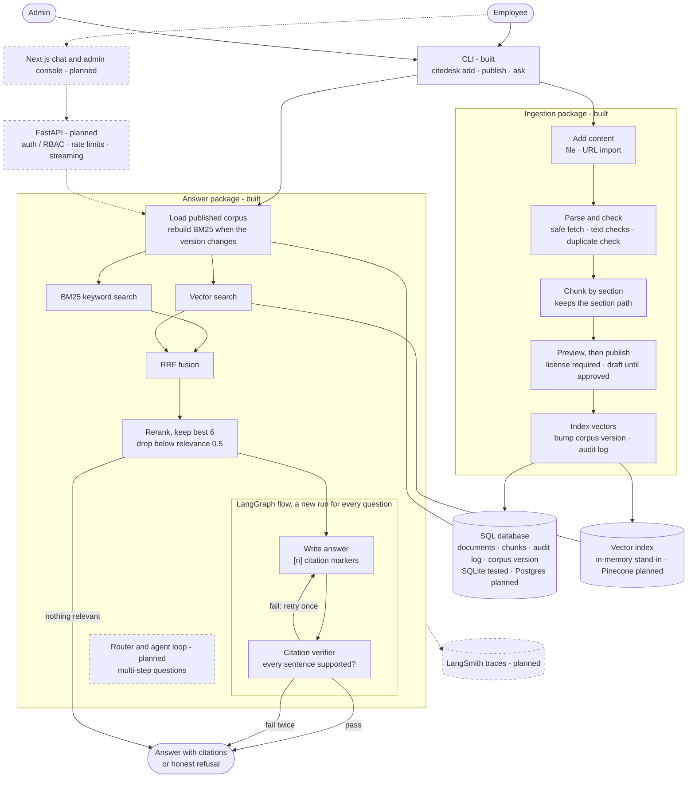
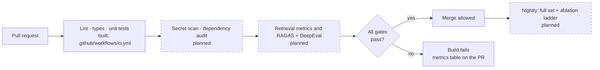
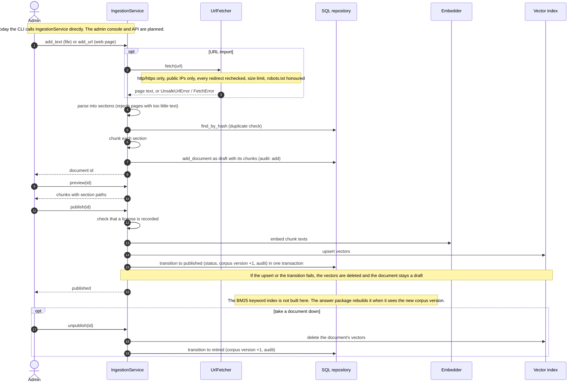
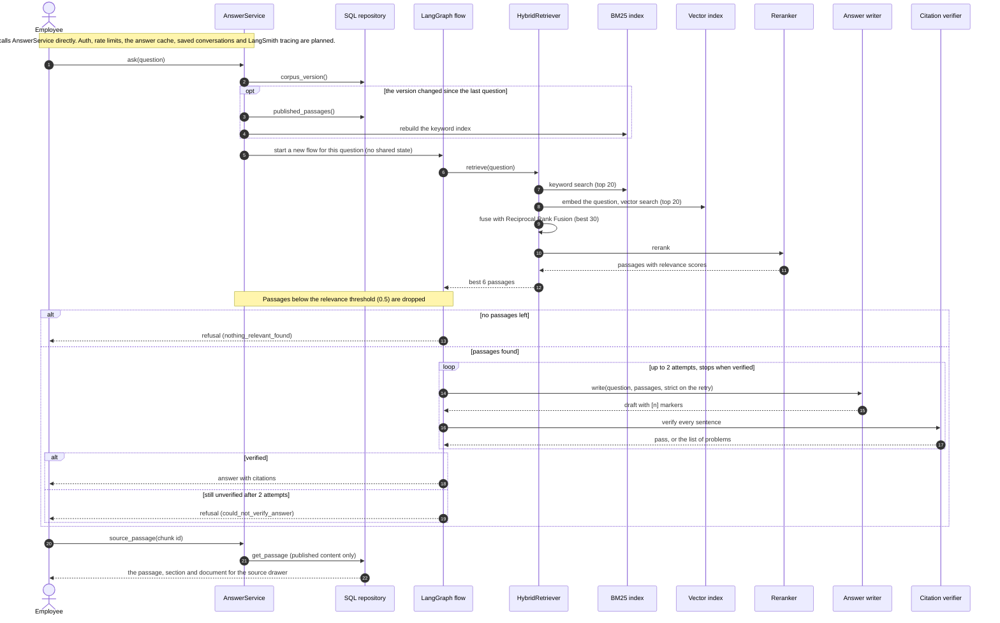

# CiteDesk

CiteDesk is a company-handbook assistant: employees ask questions in plain language and get answers where **every sentence cites the exact handbook passage it came from**. If the handbook does not support an answer, CiteDesk says so instead of guessing.

**Status:** backend core implemented and tested (ingestion, hybrid retrieval, citation verifier, LangGraph answer flow, CLI) using offline stand-ins for the vector database, embeddings and reranker. Not built yet: API, auth, web app, Pinecone and OpenAI adapters, cross-encoder, evaluation pipeline.  
**Design baseline:** October 17, 2026  
**Demo corpus:** an openly licensed company handbook, to be chosen after its reuse terms are verified (see [`docs/product/dataset-feasibility.md`](docs/product/dataset-feasibility.md)). Nothing has been downloaded or ingested.

## Why this is a RAG system

The handbook is the organization's own, changing text. A general chatbot does not know a company's current policies, and answers about policy are only useful if the reader can check the clause. CiteDesk adds four things a plain chatbot does not provide:

1. **Checkable citations.** Each sentence links to the passage, page and last-updated date.
2. **Refusal when unsupported.** A verifier blocks uncited or unsupported sentences.
3. **Admin-controlled content.** Admins upload or import documents, preview them, and publish or roll back.
4. **Measured quality.** Faithfulness, answer relevancy and context precision are scored on every pull request and block regressions.

The first release includes a head-to-head against a plain chatbot (see the evaluation strategy). If the plain chatbot matches CiteDesk on the handbook questions, the scope is wrong and we stop and rethink.

## Start here

1. [`docs/product/prd.md`](docs/product/prd.md) — users, features, acceptance criteria, non-goals.
2. [`docs/architecture/technical-architecture.md`](docs/architecture/technical-architecture.md) — components, retrieval, citation verification, agentic flow, contracts.
3. [`docs/architecture/data-flow.md`](docs/architecture/data-flow.md) — step-by-step flows for ingestion, a question, and a gated code change.
4. [`docs/product/dataset-feasibility.md`](docs/product/dataset-feasibility.md) — candidate corpora, licensing status and open questions.
5. [`docs/evaluation/evaluation-strategy.md`](docs/evaluation/evaluation-strategy.md) — metrics, gates, golden questions, CI pipeline, cost controls.
6. [`docs/architecture/deployment.md`](docs/architecture/deployment.md) — environments and operations.
7. [`docs/architecture/project-structure.md`](docs/architecture/project-structure.md) — repository layout and module dependency rules.
8. [`docs/implementation/roadmap.md`](docs/implementation/roadmap.md) — phases, gates and definition of done.
9. [`docs/architecture/adrs.md`](docs/architecture/adrs.md) — decisions and open questions.
10. [`schemas/eval-case.example.json`](schemas/eval-case.example.json) and [`schemas/dataset-manifest.example.yaml`](schemas/dataset-manifest.example.yaml) — example shapes.

## Run it locally

No API keys, Docker or cloud account are needed: the core runs on offline stand-ins and a local SQLite file.

### 1. Install the prerequisites

- **Git** and **[`uv`](https://docs.astral.sh/uv/getting-started/installation/)** (it installs the right Python, 3.12, for you).
- **`make`** is optional; it only wraps the commands in step 4.

### 2. Get the code

```bash
git clone https://github.com/Tevaalgorithms/cite-desk.git
cd cite-desk
```

### 3. Install dependencies

```bash
uv sync
```

### 4. Check that everything works

```bash
make check        # or: uv run ruff check . && uv run mypy && uv run pytest
```

You should see Ruff pass, mypy report no issues, and all tests pass.

### 5. Use the sample handbook

The repo includes a small, made-up handbook at [`data/sample/acme-handbook.md`](data/sample/acme-handbook.md) (fictional company, released as CC0). Example questions with known answers are in [`evals/sample/questions.json`](evals/sample/questions.json).

### 6. Add it, review it, publish it

```bash
uv run citedesk add data/sample/acme-handbook.md --title "Acme Handbook" --license "CC0 (synthetic sample)"
```

This saves the file as a **draft**, so nobody can search it yet, and prints its id, for example `Added e94cbc1cfce6 (2 chunks, draft)`. Publishing requires a recorded `--license`; without one it is refused.

```bash
uv run citedesk list                      # shows each document with its status
uv run citedesk publish <document-id>     # use the id printed above
```

To add and publish in one command, put `--publish` on the `add` line.

### 7. Ask questions

```bash
uv run citedesk ask "How many vacation days do I get?"
uv run citedesk ask "When do I need to return my laptop?"
uv run citedesk ask "What is the capital of France?"
```

The first two answer in the handbook's own words, with `[1]` markers and the section each came from. The third is not in the handbook, so CiteDesk says it can't answer. Try the other questions in `evals/sample/questions.json` too.

### 8. Take a document down

```bash
uv run citedesk unpublish <document-id>
uv run citedesk ask "How many vacation days do I get?"   # now refused
```

### 9. Try your own document

```bash
uv run citedesk add path/to/your-file.md --title "My document" --license "<its license>" --publish
```

Markdown (`.md`), HTML (`.html`) and plain text files are supported. PDF, DOCX and web-page import from the command line are not available yet. The importer exists in code and is tested, but has no command.

### Where things are stored

- Documents, chunks and the audit log are in a SQLite file, `citedesk.local.db`, created in the folder you run the command from. It is git-ignored.
- To start fresh, delete that file. To use another location: `export CITEDESK_DATABASE_URL="sqlite:////full/path/to/file.db"`.
- The vector index is rebuilt in memory every time a command starts.

### Good to know

- The offline stand-ins match on shared words only, so a question phrased with different words than the handbook may be refused. This is expected until the real embedding model and reranker are added.
- There is no web chat, API or admin screen yet. See the roadmap.

### Troubleshooting

| Problem | Fix |
| --- | --- |
| `uv: command not found` | Install uv (step 1), then open a new terminal |
| `Record the document's license before publishing` | Re-add the file with `--license "..."` |
| `Same content already added as document ...` | That file is already stored; use `list` to find its id |
| `Only N characters of text found` | The file has too little text (error pages and empty files are rejected on purpose) |
| An answer says it cannot answer | Check the document is published (`list`) and use words close to the handbook's. For example "parental leave" works where "time off for a baby" does not |

## What CiteDesk will do

- **Chat:** streaming answers with citation chips; clicking a chip opens the source drawer at the exact passage.
- **Hybrid retrieval:** in-process BM25 and Pinecone vector search, fused with Reciprocal Rank Fusion, then a cross-encoder reranker.
- **Citation enforcement:** a deterministic verifier checks every sentence; one stricter retry, then an honest refusal.
- **Admin console:** upload files or import URLs, preview chunks, publish, unpublish and roll back, with an audit log.
- **Quality gates:** RAGAS and DeepEval run in GitHub Actions and fail the build below thresholds.
- **Agentic RAG (optional, bounded):** only for multi-part questions, with a hard step budget. It stays only if the evaluation shows it helps.
- **Not included:** Graph RAG (a handbook is mostly prose; see ADR-005).

## Architecture

Solid boxes are built and tested. Dashed boxes are planned (see [`docs/implementation/roadmap.md`](docs/implementation/roadmap.md)).



Ingestion and the answer package never call each other. They meet only through the SQL database, the vector index and the shared interfaces in `src/citedesk/domain/ports.py`.

### Quality gate in CI



Today CI runs Ruff, strict mypy and pytest. The evaluation gates are designed in [`docs/evaluation/evaluation-strategy.md`](docs/evaluation/evaluation-strategy.md) but not implemented.

## Sequence diagrams

These follow the code in `src/citedesk/`. Steps marked planned do not exist yet.

### Ingestion path (admin adds a document)



### Retrieval and answer path (employee asks a question)



## Technology stack

| Layer | Choice |
| --- | --- |
| API | Python 3.12, FastAPI, Pydantic, `uv` |
| Orchestration | LangGraph (answer flow, optional agent), LangChain (model and retriever integrations) |
| Keyword search | In-process BM25 |
| Vector search | Pinecone dense index |
| Reranker | Cross-encoder (local ONNX model by default) |
| LLM | OpenAI behind an interface so another provider can be added |
| Metadata store | PostgreSQL |
| Observability | LangSmith, OpenTelemetry, structured logs |
| Evaluation | RAGAS, DeepEval, pytest, GitHub Actions |
| Frontend | Next.js, TypeScript, Tailwind, shadcn/ui |
| Quality tooling | Ruff, strict mypy, pytest, Vitest, Playwright, gitleaks, pip-audit, npm audit |

## Repository structure

```text
cite-desk/
  apps/web/                 Next.js: chat, admin console, quality dashboard
  src/citedesk/
    domain/                 shared data models and interfaces (ports)      [built]
    ingestion/              parse, chunk, safe URL fetch, publish workflow [built]
    answer/                 BM25, fusion, retrieval, writer, verifier, LangGraph flow [built]
    storage/                SQL repository, offline dev adapters           [built]
    bootstrap.py, cli.py    wiring and command line                        [built]
    api/                    FastAPI routes, auth, rate limits, streaming   [planned]
    llm/                    OpenAI, Pinecone and cross-encoder adapters    [planned]
    evaluation/             RAGAS and DeepEval runners, thresholds         [planned]
  evals/                    golden sets, thresholds, baselines
  infrastructure/           docker, terraform
  .github/workflows/        CI, PR evaluation, nightly evaluation, deploy
  docs/                     product, architecture, evaluation, implementation
  schemas/                  example manifests and eval cases
```

See [`docs/architecture/project-structure.md`](docs/architecture/project-structure.md) for the dependency rules between modules.

## Limits and honest caveats

- **Specification only.** Thresholds in the evaluation strategy are starting guesses; they are calibrated on the first measured baseline.
- **"Production-ready" means** the tests, gates, monitoring, backups and runbook exist and have been exercised. It does not mean the system has run under real load or on confidential data.
- **LLM judges vary** between runs, so gates use tolerance bands and cached judgments.
- **Corpus licensing is unverified.** No document is ingested until its terms are recorded in the source registry.
- CiteDesk gives information from the handbook it is given. It is not HR, legal or compliance advice.

## License

GPL-3.0. See [`LICENSE`](LICENSE).
