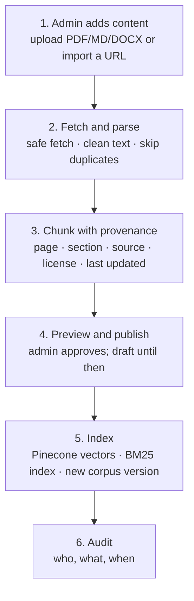
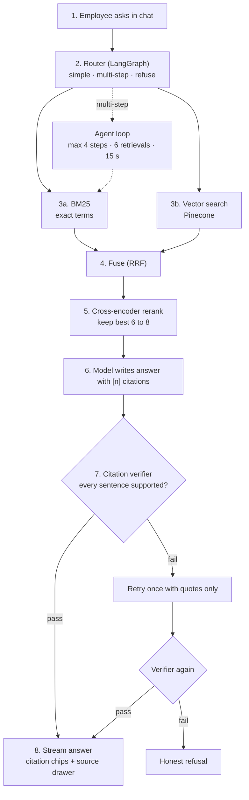
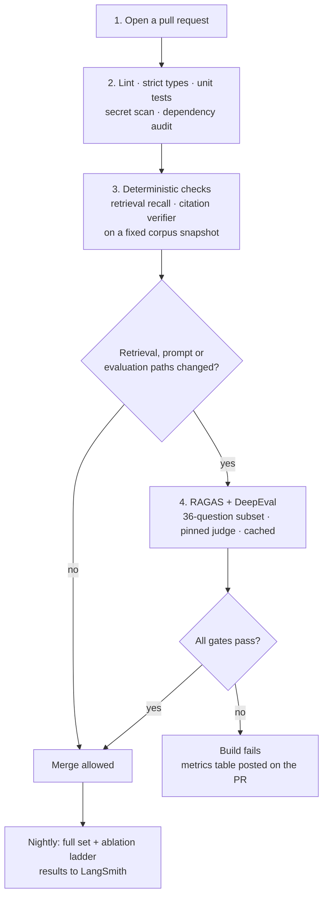

# CiteDesk — Data Flow

Three flows: content in, a question answered, and a code change gated.

## 1. Content in (admin)

| Step | What happens | Failure handling |
| --- | --- | --- |
| Add | Upload or URL import | Reject disallowed types and oversized files |
| Fetch and parse | http/https only; private and metadata addresses blocked; size and redirect limits; robots.txt honoured | Error and login pages are rejected by a minimum-text check; duplicates by content hash are flagged |
| Chunk | Section-aware chunks keep source, section path, page, offsets, license and date | Parse failures leave the document in draft with the error shown |
| Preview and publish | Admin can exclude chunks or the whole document | Nothing is retrievable until published |
| Index | Embeds and indexes chunks, rebuilds BM25, bumps the corpus version, which invalidates cached answers | A failed index leaves the previous version live |
| Rollback | One click restores the previous corpus version | Pinecone is rebuildable from Postgres chunks |

## 2. A question answered (employee)

| Step | Detail |
| --- | --- |
| Router | Classifies the question: single lookup, multi-step, or out of scope. Out-of-scope questions get a short decline with no retrieval |
| Retrieve | BM25 and vector search run in parallel against published chunks only |
| Fuse and rerank | Reciprocal Rank Fusion on the union, cross-encoder on the top 30, keep 6 to 8 |
| Generate | The model sees numbered passages and must mark each sentence |
| Verify | Deterministic checks first, then a support check for paraphrases |
| Respond | Pass: stream with citations. Second failure: refuse and offer to flag a content gap |
| Record | LangSmith trace and a stored message record (question hash, chunk ids, verification result, versions) |

Cache: an exact-key answer cache keyed on normalized question, corpus version, and prompt and model versions. No semantic answer cache in the MVP.

## 3. A code change gated (developer)

Pull requests from forks run only steps 1 to 3, because repository secrets are not shared with forks.
