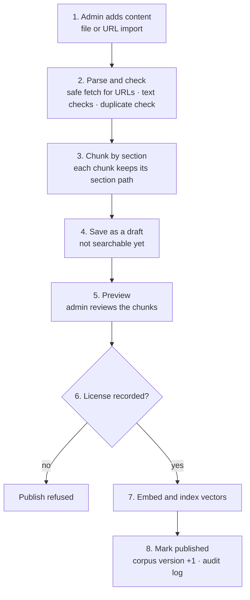
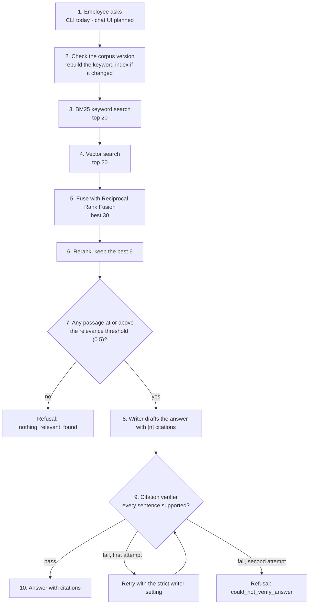
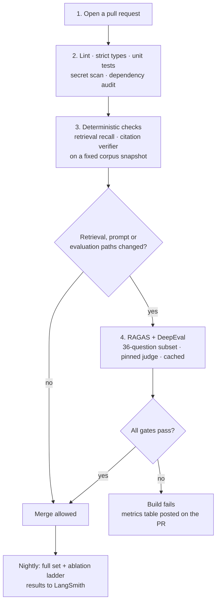

# CiteDesk — Data Flow

Three flows: content in, a question answered, and a code change gated.

## Status

Flows 1 and 2 are implemented in `src/citedesk/` and driven today by the command line. The API, auth, rate limits, answer cache, saved conversations, router and agent loop, and LangSmith tracing are planned and are marked as such below. Flow 3 is only partly implemented (see its note).

## 1. Content in (admin)

| Step | What happens | Failure handling |
| --- | --- | --- |
| Add | Markdown, HTML or plain text from a file, or a web page by URL | Web pages with an unsupported content type are rejected. Local files with an unknown extension are read as plain text |
| Parse and check | URLs: http/https only, public IP addresses only, every redirect rechecked, size limit, robots.txt honoured. Text: pages with too little text (error and login pages) are rejected, duplicates are found by content hash | `UnsafeUrlError`, `FetchError`, `ParseError`, `DuplicateDocumentError` |
| Chunk | Sentence-aware chunks of at most about 1,200 characters, with one sentence of overlap inside long sections. Chunks never cross a section | A section with no text produces no chunk |
| Save as draft | Document and chunks are stored and an `add` audit entry is written | Nothing is searchable yet |
| Preview | The admin sees the chunks and their section paths | Planned: excluding single chunks |
| License gate | Publishing needs a recorded license (ADR-011) | `PublishBlockedError`, document stays a draft |
| Index | Chunk text is embedded and the vectors are upserted | If the upsert or the status change fails, the vectors are removed and the document stays a draft |
| Publish | Status, corpus version and audit entry change in one transaction | Unpublish removes the vectors, marks the document retired and bumps the version |

The keyword (BM25) index is **not** built by ingestion. The answer package rebuilds it on the next question after it sees a new corpus version, which keeps the two packages independent. Page numbers, chunk exclusion and PDF or DOCX parsing are planned.

## 2. A question answered (employee)

| Step | Detail |
| --- | --- |
| Corpus version | The answer package asks the repository for the current version and reloads published passages only when it changed |
| Retrieve | Keyword and vector search run one after the other over published chunks only. Vectors of content no longer published are ignored |
| Fuse and rerank | Reciprocal Rank Fusion on both lists, then the reranker scores each passage 0 to 1 |
| Relevance threshold | Passages below `min_relevance` (default 0.5) are dropped, so loosely matching text is refused rather than quoted |
| Write | The writer sees numbered passages and must mark each sentence. The offline default quotes the best sentence of each close match |
| Verify | Deterministic checks: every sentence cited, markers exist, quotes verbatim, numbers present in the cited passage, enough of the words supported |
| Respond | Pass: answer plus citations. A second failure: refusal. Each question gets its own flow run, with no shared state |

Planned and not built: a router that sends multi-step questions to a bounded agent loop, an exact-key answer cache, authentication and rate limits, saved conversations and feedback, and LangSmith traces.

## 3. A code change gated (developer)

Pull requests from forks run only steps 1 to 3, because repository secrets are not shared with forks.

**Implemented today:** `.github/workflows/ci.yml` runs Ruff, strict mypy and pytest. The secret scan, dependency audit, retrieval metrics, RAGAS and DeepEval steps are planned.
