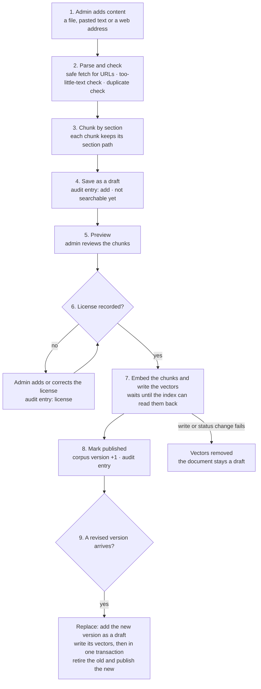
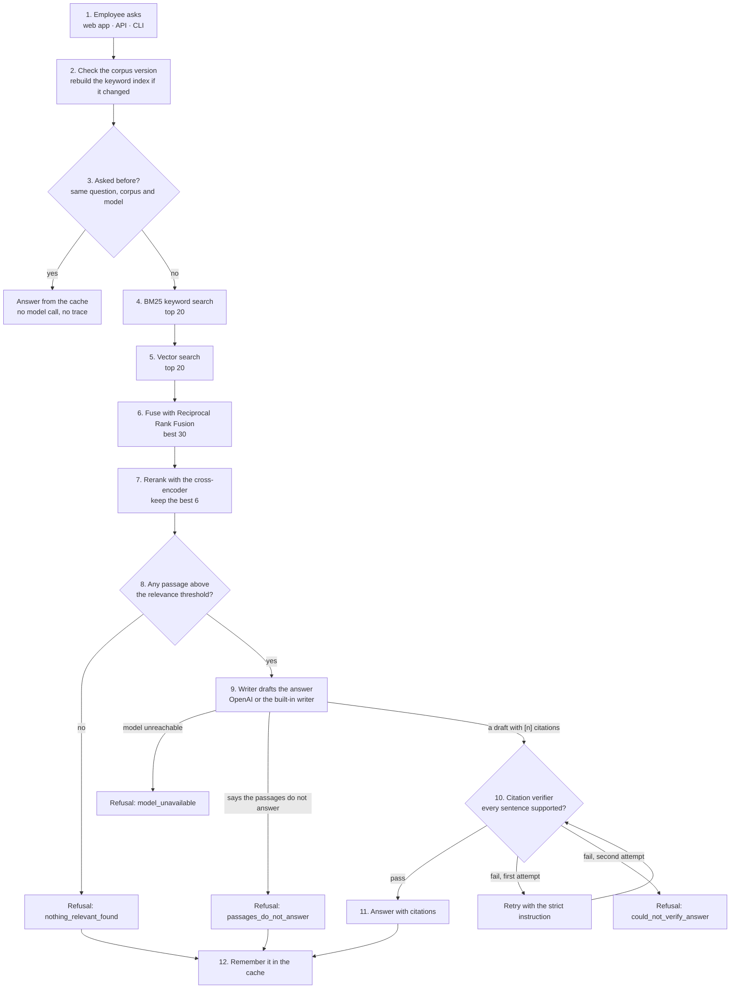
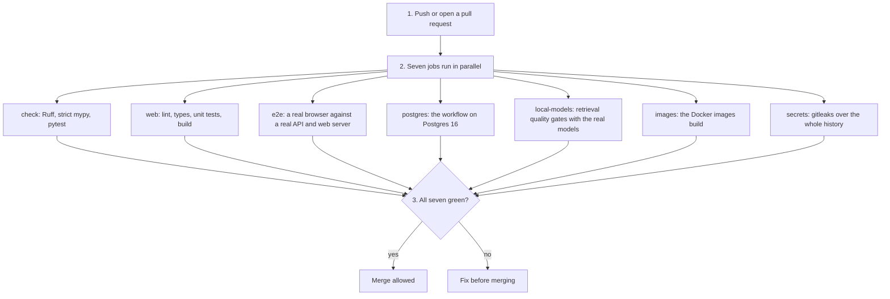

# CiteDesk — Data Flow

Three flows: content in, a question answered, and a code change gated. The README has the system overview and the step-by-step sequence diagrams; this page is the same story as plain flowcharts, with the failure handling in tables.

## Status

Flows 1 and 2 are built and tested, through the web app, the API and the command line. Not built: company sign-in (OIDC), streaming answers, saved conversations and feedback, and the RAGAS and DeepEval steps of flow 3 (on hold). An agent loop was measured and deliberately not built (ADR-018).

## 1. Content in (admin)

| Step | What happens | Failure handling |
| --- | --- | --- |
| Add | Markdown, HTML or plain text from a file or pasted text, or a web page by address. Through the API the admin role is required and requests are rate limited | Web pages with an unsupported content type are rejected. Local files with an unknown extension are read as plain text |
| Parse and check | URLs: http/https only, public IP addresses only, every redirect rechecked, size limit, robots.txt honoured. Text: pages with too little text (error and login pages) are rejected; duplicates are found by content hash | `UnsafeUrlError`, `FetchError`, `ParseError`, and a duplicate message that names the existing document |
| Chunk | Sentence-aware chunks of at most about 1,200 characters, with one sentence of overlap inside long sections. Chunks never cross a section. The admin's title wins over the title found in the file | A section with no text produces no chunk |
| Save as draft | Document and chunks are stored and an `add` audit entry is written | Nothing is searchable yet |
| Preview | The admin sees the chunks and their section paths | Excluding single chunks is not built |
| License gate | Publishing needs a recorded license (ADR-011). A missing one is added or corrected in the table (inline editor, `POST .../license`, or `citedesk license`) | The publish is refused with a clear message; the document stays a draft |
| Embed and write | Chunk text is embedded by the local model and the vectors are written to the vector index (in memory or Pinecone). Pinecone applies writes late, so the write waits until the vectors can be read back | If the write or the status change fails the vectors are removed and the document stays a draft |
| Publish | Status, corpus version and audit entry change in one transaction | Unpublish removes the vectors (and waits until they are gone), marks the document retired and bumps the version |
| Replace | A revised version of a published document is added (title, source and license carry over), its vectors are written, then one transaction retires the old and publishes the new (corpus version +1 once), then the old vectors are deleted (ADR-021) | Before the swap a failure removes the new vectors and the old version stays live. If only the old vectors cannot be deleted the swap stands: searches ignore them and the repair at start removes them |

The keyword (BM25) index is **not** built by ingestion. The answer package rebuilds it on the next question after it sees a new corpus version, which keeps the two packages independent and also stops remembered answers from being served. Page numbers, chunk exclusion and PDF or DOCX parsing are not built.

## 2. A question answered (employee)

| Step | Detail |
| --- | --- |
| Corpus version | The answer package asks the database for the current version and reloads the published passages only when it changed |
| Cache | An exact-match, in-memory cache keyed on the question (case, spacing and end punctuation ignored), the corpus version and a label for the writer, model and threshold. Publishing, unpublishing or switching models therefore stops old answers from being served |
| Retrieve | Keyword and vector search run one after the other over published chunks only. Vectors of content no longer published are ignored, which also covers Pinecone's late deletes |
| Fuse and rerank | Reciprocal Rank Fusion on both lists, then the cross-encoder scores each passage |
| Relevance threshold | Passages below `min_relevance` are dropped, so loosely matching text is refused rather than quoted. The value is calibrated for the chosen models (about -10 on the cross-encoder's scale) |
| Write | The model sees the numbered passages and must end every sentence with the number of its passage. It is told to use only the passages and to reply `NO_ANSWER` when they do not contain the answer. The built-in writer instead quotes the best sentence of the best passage |
| Verify | Deterministic checks: every sentence cited, the markers exist, quotes are verbatim, numbers appear in the cited passage, enough of the words are supported |
| Respond | Pass: answer plus citations. Each question gets its own flow run with no shared state |
| Remember | Verified answers and the two refusals that follow from the documents are cached. A model outage and a failed verification are never cached, because they may succeed next time |
| Trace | With `CITEDESK_LANGSMITH_TRACING=true` each run is sent to LangSmith with its steps, timings and the model call. Off by default, because a trace contains the question and (unless hidden) the passages |

Not built: streaming answers, saved conversations and feedback, company sign-in. Through the API a request first passes the sign-in token check, the role check and the rate limit.

## 3. A code change gated (developer)

The quality gates compare the retrieval and answer metrics with `evals/baselines.json` and fail if recall, correct answers or multi-part coverage fall, or if confidently wrong answers rise. Tests that use the real OpenAI, Pinecone and LangSmith services run only on request (a few cents each) and never in CI. The dependency audit, the RAGAS and DeepEval gates, and a nightly full evaluation are not built.
